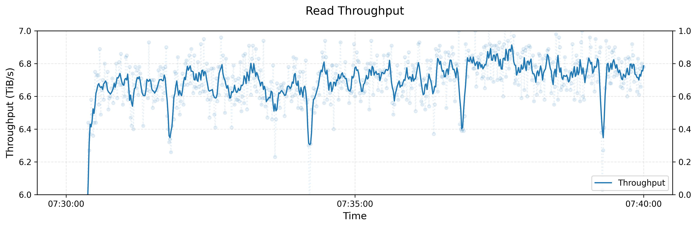
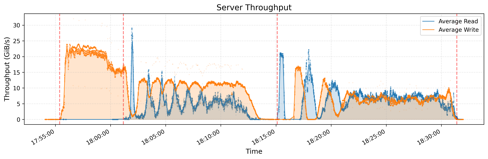
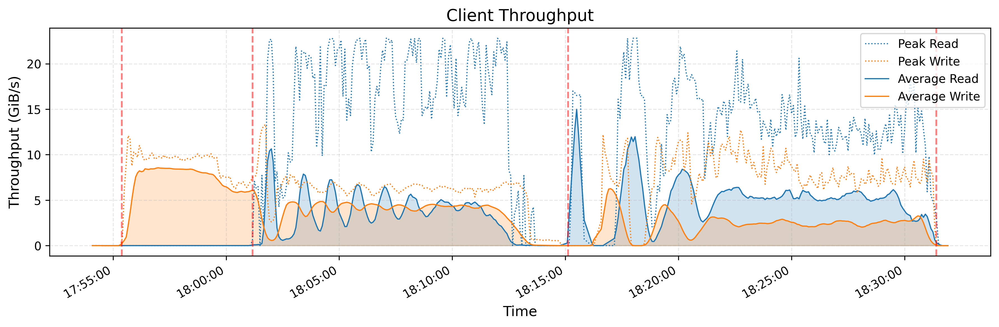
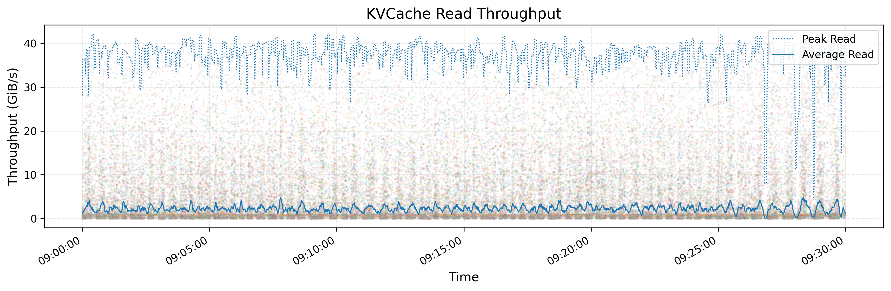
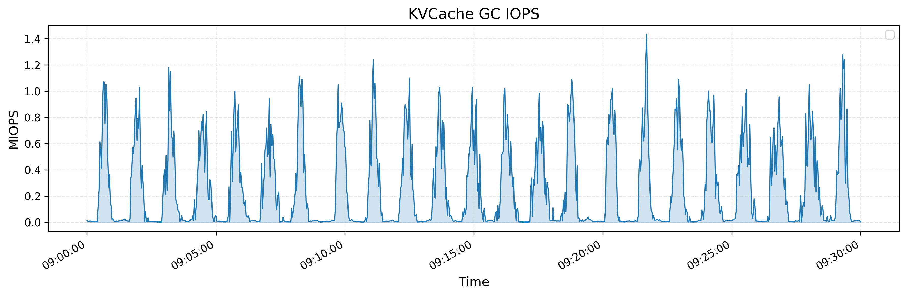

# Fire-Flyer 文件系统 (3FS)

[](https://github.com/deepseek-ai/3fs/actions/workflows/build.yml)
[](LICENSE)

[ [English](https://github.com/deepseek-ai/3FS/blob/main/README.md) | 简体中文 ]

Fire-Flyer 文件系统（3FS）是一款高性能分布式文件系统，专为应对 AI 训练与推理工作负载中的严苛数据挑战而设计。它充分发挥现代 NVMe SSD 与高速 RDMA 网络的硬件性能，提供统一的共享存储层，大幅简化分布式应用的开发。3FS 的核心特性与优势包括：

- 卓越性能与易用性
  - **存储计算解耦架构（Disaggregated Architecture）**：聚合数千块 SSD 的 I/O 吞吐能力与数百个存储节点的高速网络带宽，使应用程序无需感知物理位置（Locality-oblivious）即可高效访问存储资源。
  - **强一致性（Strong Consistency）**：基于带分摊查询的链式复制（Chain Replication with Apportioned Queries, CRAQ）协议实现强一致性，使应用层代码逻辑清晰且易于推导分析。
  - **标准文件接口（File Interfaces）**：构建由事务型键值存储（如 FoundationDB）作为后端的无状态元数据服务。文件系统接口通用且易于集成，无需额外学习专有存储 API。

- 适配多样化 AI 工作负载
  - **数据准备（Data Preparation）**：将数据分析流水线的输出高效组织为分层目录结构，并轻量管理海量中间数据。
  - **数据加载器（Dataloaders）**：支持跨计算节点对训练样本进行随机并发访问，免去繁琐的数据预取（prefetching）与全局重排（shuffling）。
  - **检查点保存（Checkpointing）**：为超大规模分布式模型训练提供超高吞吐的并行检查点写入与恢复能力。
  - **推理 KV 缓存（KVCache for Inference）**：提供相比纯 DRAM 缓存更具成本效益的存储替代方案，在提供超高读取吞吐的同时实现数倍容量扩展。

## 文档指南

* [架构设计文档](docs/design_notes.md)
* [部署与搭建指南](deploy/README.md)
* [USRBIO API 参考规范](src/lib/api/UsrbIo.md)
* [P 语言形式化规范验证](./specs/README.md)

## 性能表现

### 1. 峰值读取吞吐量

下图展示了在大型 3FS 生产集群上执行读取压力测试的吞吐表现。该集群由 180 个存储节点组成，每个节点配备 2×200Gbps InfiniBand 网卡与 16 块 14TiB NVMe SSD。测试使用了 500+ 个客户端节点进行并发读取压测，每个客户端配置 1×200Gbps InfiniBand 网卡。在集群同时承载模型训练背景流量的真实场景下，最终聚合读取吞吐量达到约 **6.6 TiB/s**。



如需对 3FS 进行基准评测，请使用我们提供的 [USRBIO fio 引擎](benchmarks/fio_usrbio/README.md)。

### 2. GraySort 排序基准

我们使用衡量海量数据集排序性能的 GraySort 基准测试评测了 [smallpond](https://github.com/deepseek-ai/smallpond)。我们的实现采用了两阶段处理方式：(1) 利用键前缀位通过 Shuffle 对数据进行分区；(2) 分区内并行排序。两个阶段的数据读写均完全在 3FS 上进行。

测试集群包含 25 个存储节点（每个节点 2 个 NUMA 域，每个 NUMA 域部署 1 个存储服务，单节点配备 2×400Gbps 网卡）以及 50 个计算节点（2 个 NUMA 域，192 颗物理核心，2.2 TiB 内存，单节点配备 1×200 Gbps 网卡）。在 8,192 个分区上对 **110.5 TiB** 数据完成全量排序仅耗时 30 分 14 秒，平均吞吐量达到 **3.66 TiB/min**。




### 3. KVCache 推理缓存

KVCache 是用于加速大模型（LLM）解码推理过程的关键技术，通过在解码器各层中缓存前序 Token 的 Key 和 Value 向量，避免重复冗余计算。
上方图表展示了所有 KVCache 客户端（单节点配置 1×400Gbps 网卡）的读取吞吐量，包含峰值与平均值，其中峰值吞吐量高达 **40 GiB/s**。下方图表展示了同一时间段内后台垃圾回收（GC）执行删除操作时的 IOPS 表现。




## 源码检出

从 GitHub 克隆 3FS 仓库：

```bash
git clone https://github.com/deepseek-ai/3fs
```

当 `deepseek-ai/3fs` 克隆到本地后，运行以下命令拉取子模块并应用补丁：

```bash
cd 3fs
git submodule update --init --recursive
./patches/apply.sh
```

## 安装依赖

安装系统依赖库：

```bash
# 适用于 Ubuntu 20.04
apt install cmake libuv1-dev liblz4-dev liblzma-dev libdouble-conversion-dev libdwarf-dev libunwind-dev \
  libaio-dev libgflags-dev libgoogle-glog-dev libgtest-dev libgmock-dev clang-format-14 clang-14 clang-tidy-14 lld-14 \
  libgoogle-perftools-dev google-perftools libssl-dev libclang-rt-14-dev gcc-10 g++-10 libboost1.71-all-dev build-essential

# 适用于 Ubuntu 22.04
apt install cmake libuv1-dev liblz4-dev liblzma-dev libdouble-conversion-dev libdwarf-dev libunwind-dev \
  libaio-dev libgflags-dev libgoogle-glog-dev libgtest-dev libgmock-dev clang-format-14 clang-14 clang-tidy-14 lld-14 \
  libgoogle-perftools-dev google-perftools libssl-dev gcc-12 g++-12 libboost-all-dev build-essential

# 适用于 openEuler 2403sp1
yum install cmake libuv-devel lz4-devel xz-devel double-conversion-devel libdwarf-devel libunwind-devel \
    libaio-devel gflags-devel glog-devel gtest-devel gmock-devel clang-tools-extra clang lld \
    gperftools-devel gperftools openssl-devel gcc gcc-c++ boost-devel

# 适用于 OpenCloudOS 9 与 TencentOS 4
dnf install epol-release wget git meson cmake perl lld gcc gcc-c++ autoconf lz4 lz4-devel xz xz-devel \
    double-conversion-devel libdwarf-devel libunwind-devel libaio-devel gflags-devel glog-devel \
    libuv-devel gmock-devel gperftools gperftools-devel openssl-devel boost-static boost-devel mono-devel \
    libevent-devel libibverbs-devel numactl-devel python3-devel
```

安装其他构建前置环境：

- [`libfuse`](https://github.com/libfuse/libfuse/releases/tag/fuse-3.16.1) 3.16.1 或更高版本
- [FoundationDB](https://apple.github.io/foundationdb/getting-started-linux.html) 7.1 或更高版本
- [Rust](https://www.rust-lang.org/tools/install) 工具链：最低 1.75.0，推荐 1.85.0 或更高版本（最新稳定版）

## 编译构建 3FS

在 `build` 目录下编译构建 3FS：

```bash
# 根据您的环境将 <method> 替换为 'g++10' 或 'g++11'
cmake -S . -B build \
      -DCMAKE_CXX_COMPILER=clang++-14 -DCMAKE_C_COMPILER=clang-14 \
      -DCMAKE_BUILD_TYPE=RelWithDebInfo -DCMAKE_EXPORT_COMPILE_COMMANDS=ON \
      -DSHUFFLE_METHOD=<method>
cmake --build build -j 32
```

由于代码中历史使用了 `std::shuffle`，不同编译器版本（例如 `g++10` 与 `g++11 +`）生成的二进制可能会存在兼容性差异（详见 [issue #368](https://github.com/deepseek-ai/3FS/issues/368)）。为此，编译时必须显式指定 `-DSHUFFLE_METHOD` 以锁定一致的洗牌打乱算法：

- 既有存量集群：使用与最初部署该集群时所用编译器版本相对应的方法（`g++10` 或 `g++11`）。
- 新建集群：可任意选择 `g++10` 或 `g++11`。但集群完成部署后，后续所有构建必须保持相同的配置以确保二进制兼容。

### 使用 Docker 编译 3FS
- 适用于 TencentOS-4：`docker pull docker.io/tencentos/tencentos4-deepseek3fs-build:latest`
- 适用于 OpenCloudOS-9：`docker pull docker.io/opencloudos/opencloudos9-deepseek3fs-build:latest`

## 运行测试集群

请遵循[部署指南](deploy/README.md)中的步骤启动测试集群。

## 问题反馈与交流

如遇到任何问题或 Bug，请前往 https://github.com/deepseek-ai/3fs/issues 提交 Issue。

---

> _注：本中文文档由社区志愿者翻译与维护，旨在降低中文开发者的阅读门槛。如与英文原版存在差异或更新延迟，请以英文原版 [README.md](https://github.com/deepseek-ai/3FS/blob/main/README.md) 为唯一权威标准（Single Source of Truth）。_
